# 📊 Awesome Data Science Presentation & Notebook Visualization 🚀

**A curated, production-grade guide to reactive notebooks, interactive data apps, reporting frameworks, and modern visualization platforms.**

  <a href="#-sector-overview--market-dynamics">📈 Sector Overview</a> •
  <a href="#-saashosted-platforms">☁️ SaaS Platforms</a> •
  <a href="#-open-source-github-projects">💻 Open-Source Projects</a> •
  <a href="#-star-history">⭐ Star History</a> •
  <a href="#-support--sponsor">☕ Support</a> •
  <a href="#-how-to-contribute">🤝 Contribute</a>

---

## 📌 Overview & Scope

Modern data science requires communicating insights through reproducible, high-performance, and visually engaging mediums. This directory tracks the entire **Data Science Presentation & Notebook Visualization** ecosystem:
- ⚡ **Reactive Notebooks & Workspaces** (Marimo, Hex, Deepnote) eliminating hidden notebook states.
- 📱 **Interactive Data Applications & Dashboards** (Streamlit, Gradio, Taipy, Panel, Dash).
- 📑 **Publication-Ready Scientific Reporting** (Quarto, Jupyter Book, Evidence BI-as-code).
- 📊 **Enterprise BI & Exploration Engines** (Apache Superset, JupyterLab, Observable Plot, Bokeh).

---

## 📈 Sector Overview & Market Dynamics

The global data science and machine learning platform market is estimated at **~$100B–$130B+** (projected to surpass **$500B by the 2030s** at an **~18–25% CAGR**), catalyzed by enterprise generative AI mandates, BI modernization, and demand for interactive data applications. 

The sector is **moderately to highly fragmented** rather than a winner-take-all monopoly:
- **Cloud Hyperscalers & Lakehouses** (AWS, Azure, Google Cloud Vertex/Colab, Databricks, Snowflake) govern heavy data storage, compute, and enterprise governance.
- **Specialized Workspaces & Open-Source Frameworks** (Hex, Deepnote, Streamlit, Marimo, Quarto, Taipy, Superset) capture developer mindshare by solving critical developer ergonomics, reactive DAG state management, self-hosting privacy, and rapid stakeholder data app delivery.

---

## ☁️ SaaS/Hosted Platforms

> [!NOTE]
> Platforms are sorted descending by company size (valuation / revenue). Pricing reflects starting paid tiers, and free tier limits detail real compute/seat allocations.

| Platform | Company Size (Valuation / Revenue) | Starting Paid Tier Pricing | Free Tier Limits | Description |
| :--- | :--- | :--- | :--- | :--- |
| **[Google Colab](https://colab.research.google.com/)** | **Parent: Alphabet / Google** (~$2.1T+ Market Cap, $350B+ Annual Revenue) | **$9.99/month** (Colab Pro, 100 compute units; or $9.99 Pay-As-You-Go) | **Free forever**: Limited shared compute (T4 GPU subject to dynamic availability and quotas); max 12h runtime; idle timeouts after short inactivity. | Cloud-hosted Jupyter environment for ML experimentation, quick prototyping, and GPU/TPU compute. |
| **[Streamlit Community Cloud](https://streamlit.io/cloud)** | **Parent: Snowflake** (~$800M Acquisition; Snowflake ~$50B+ Market Cap, $3.5B+ Annual Revenue) | **Free Community Cloud** / Streamlit in Snowflake (SiS) starts via Snowflake Virtual Warehouses at **~$2.00–$3.00/credit-hour** (XS Warehouse consumes 1 credit/hr) | **Free forever**: Unlimited public apps; 1 private app; up to 2.7 GB RAM and 2 vCPUs per app container; apps sleep after 12h inactivity. | Rapid deployment platform converting Python scripts into interactive, shareable data applications and internal tools. |
| **[Hex.tech](https://hex.tech/)** | **$1.2B Valuation** ($272M+ Funding, ~$6M–$15M+ ARR) | **$36/editor/month** (Professional tier, billed annually) | **Free forever**: 1 editor seat, up to 5 published apps, small shared compute profile, limited monthly AI actions. | Collaborative workspace combining SQL, Python, and reactive visual components into interactive stakeholder data apps. |
| **[Observable Cloud](https://observablehq.com/)** | **~$142M Valuation** ($46.1M Funding, ~$5M+ ARR) | **$22/month** (Pro tier, billed annually; or $25 month-to-month) | **Free forever**: Unlimited public notebooks, unlimited editors/viewers on Free Teams; strictly public data only (no private notebooks/connections). | Collaborative data canvas and reactive notebook environment for D3/Observable Plot visualizations and interactive reports. |
| **[Deepnote](https://deepnote.com/)** | **~$80M Valuation** ($23.8M Funding, ~$3M+ ARR) | **$39/editor/month** (Team tier, billed annually; or $59/editor/month billed monthly) | **Free forever**: Up to 3 editors, unlimited viewers, up to 5 projects, Basic compute (2 vCPUs, 5 GB RAM), 7-day revision history, limited AI credits. | Real-time collaborative cloud Jupyter notebook environment designed for data science teams and dashboard deployment. |
| **[Saturn Cloud](https://saturncloud.io/)** | **~$25M–$50M Valuation** ($9.5M Funding, ~$2M–$5M ARR) | **Pay-As-You-Go** starting at **$0.04/hour** (CPU, e.g. t3.medium) / **$0.53/hour** (T4 GPU); $0.10/GB-month storage | **Free forever**: 30 hours of free compute per month, access to JupyterLab, RStudio, and Dask clusters; subject to inactivity timeouts. | Managed cloud data science platform offering auto-scaling GPU/CPU clusters, Dask pipelines, and dashboard hosting. |
| **[Marimo (molab)](https://marimo.io/)** | **Acquired by CoreWeave** (Pre-acquisition $5M Seed; CoreWeave ~$19B–$23B Valuation) | **Free in Public Preview** (molab cloud service); open-source enterprise/self-hosted configurations | **Free forever (preview)**: 4 vCPUs, 32 GB RAM per notebook; opt-in NVIDIA RTX Pro 6000 GPU access; 12-hour session limit; 90-minute idle timeout. | Reactive, deterministic Python notebook platform running without hidden state; deploys notebooks as interactive web apps. |

---

## 💻 Open-Source GitHub Projects

> [!TIP]
> Open-source projects are ordered **descending by GitHub star count**. Each project includes a live stargazer badge linking directly to its stargazer community.

### 1. [Apache Superset](https://github.com/apache/superset) 
* **License:** Apache-2.0 | **Primary Language:** Python, TypeScript  
* **Description:** Enterprise-ready business intelligence, data exploration, and visualization platform. Connects to almost any SQL database or data warehouse, provides a no-code visual chart builder, an advanced SQL IDE (SQL Lab), and scalable, granular security policies.  
* **Best For:** Large-scale enterprise dashboards and data exploration without per-seat licensing costs.

### 2. [Streamlit](https://github.com/streamlit/streamlit) 
* **License:** Apache-2.0 | **Primary Language:** Python  
* **Description:** The most widely adopted framework for turning plain Python scripts into interactive, shareable data applications. Reruns scripts cleanly upon widget interactions, offers built-in `@st.cache_data` decorators, and provides 30+ layout and visualization components.  
* **Best For:** Rapid dashboard building, ML demos, and internal analytics tools in pure Python.

### 3. [Gradio](https://github.com/gradio-app/gradio) 
* **License:** Apache-2.0 | **Primary Language:** Python, TypeScript  
* **Description:** Rapid UI library designed specifically for machine learning models and multimodal Python applications. Wrap any Python function with intuitive inputs and outputs, launch interactive web interfaces, and generate public shareable links in seconds.  
* **Best For:** Generative AI demos, computer vision/NLP model showcases, and quick UI prototyping.

### 4. [Plotly Dash](https://github.com/plotly/dash) 
* **License:** MIT | **Primary Language:** Python, JavaScript  
* **Description:** Robust framework for building production-grade analytical web applications in Python, R, and Julia without writing JavaScript. Integrates deeply with Plotly.js charts and reactive functional callbacks for granular state handling.  
* **Best For:** Complex, mission-critical analytical applications requiring customized layouts and fine-grained UI reactivity.

### 5. [Marimo](https://github.com/marimo-team/marimo) 
* **License:** Apache-2.0 | **Primary Language:** Python  
* **Description:** Modern, reactive, and deterministic Python notebook environment. Eliminates Jupyter's hidden-state issues through an automatic variable dependency DAG: running a cell recalculates dependents, while deleting cells clears state. Notebooks double as scripts, tests (`pytest`), and standalone web applications (`marimo run`).  
* **Best For:** Reproducible research, git-friendly notebook workflows, and instant notebook-to-app conversion.

### 6. [Bokeh](https://github.com/bokeh/bokeh) 
* **License:** BSD-3-Clause | **Primary Language:** Python, TypeScript  
* **Description:** Interactive visualization library that renders elegant, versatile graphics in modern web browsers over large streaming datasets. Supplies both concise high-level interfaces and detailed control over visual layouts and interactive tools.  
* **Best For:** Interactive web charts, large streaming data visualizations, and standalone HTML presentation graphs.

### 7. [Taipy](https://github.com/Avaiga/taipy) 
* **License:** Apache-2.0 | **Primary Language:** Python  
* **Description:** Full-stack open-source Python framework designed to turn data science algorithms into production-ready web applications. Features optimized front-end components, built-in scenario management, pipeline execution, and what-if analysis orchestration.  
* **Best For:** Enterprise data apps requiring pipeline scheduling, scenario comparison, and high concurrency.

### 8. [JupyterLab](https://github.com/jupyterlab/jupyterlab) 
* **License:** BSD-3-Clause | **Primary Language:** TypeScript, Python  
* **Description:** The industry standard extensible web-based development environment for notebooks, code, and data. Highly modular architecture supporting custom extensions, language kernels, git workflows, and interactive terminal consoles.  
* **Best For:** Core exploratory data analysis, interactive computing, and extensible workbench workflows.

### 9. [Evidence](https://github.com/evidence-dev/evidence) 
* **License:** MIT | **Primary Language:** JavaScript, Svelte  
* **Description:** Business intelligence as code. Data teams build fast, version-controlled markdown reports powered directly by SQL queries. Supports code review via git, static generation, CI/CD deploys, and AI coding assistants.  
* **Best For:** Analysts and analytics engineers who want version-controlled BI reports without clunky drag-and-drop tools.

### 10. [Quarto](https://github.com/quarto-dev/quarto-cli) 
* **License:** MIT | **Primary Language:** TypeScript  
* **Description:** Next-generation open-source scientific and technical publishing system built on Pandoc. Interweaves markdown text with computational code from Python, R, Julia, and Observable to generate publication-quality articles, presentations, books, and websites.  
* **Best For:** Academic research, technical documentation, PDF reports, and executive presentations.

### 11. [Voila](https://github.com/voila-dashboards/voila) 
* **License:** BSD-3-Clause | **Primary Language:** Python  
* **Description:** Transforms existing Jupyter notebooks into secure, standalone interactive web applications. Hides raw code cells and execute endpoints, maintaining a live Jupyter kernel to handle user widget interactions safely.  
* **Best For:** Converting existing Jupyter notebooks into web dashboards without rewriting code.

### 12. [Panel](https://github.com/holoviz/panel) 
* **License:** BSD-3-Clause | **Primary Language:** Python  
* **Description:** Flexible data exploration and dashboard framework for Python from the HoloViz ecosystem. Connects widgets to plots, tables, and data pipelines across Bokeh, Plotly, Matplotlib, Altair, and PyScript/WASM.  
* **Best For:** Complex multi-page dashboards and interactive scientific computing workflows.

### 13. [Observable Plot](https://github.com/observablehq/plot) 
* **License:** ISC | **Primary Language:** JavaScript  
* **Description:** Concise, expressive JavaScript library for exploratory data visualization. Built on web standards, offering a layered grammar of graphics that works seamlessly in Observable notebooks, vanilla HTML, React, and Vue applications.  
* **Best For:** Web-native data visualizations and interactive chart embedding in modern web frontend stacks.

### 14. [Jupyter Book](https://github.com/jupyter-book/jupyter-book) 
* **License:** BSD-3-Clause | **Primary Language:** Python  
* **Description:** Generates publication-ready HTML books and PDF documents from collections of Jupyter notebooks and Markdown files with cross-references, equations, and interactive figures.  
* **Best For:** Textbooks, academic course material, and long-form technical documentation.

### 15. [HoloViews](https://github.com/holoviz/holoviews) 
* **License:** BSD-3-Clause | **Primary Language:** Python  
* **Description:** High-level data analysis and visualization library designed to make data analysis and presentation seamless by declaring continuous data spaces rather than manually plotting charts.  
* **Best For:** Exploratory data pipelines that need automated, interactive visual representations.

### 16. [nteract](https://github.com/nteract/nteract) 
* **License:** BSD-3-Clause | **Primary Language:** TypeScript, Rust  
* **Description:** Modern desktop notebook application built with Tauri and React, complete with a background runtime daemon and MCP server capabilities for AI agent collaboration.  
* **Best For:** Local-first desktop notebook workflows and AI-assisted data analysis.

---

## ⭐ Star History

---

## ☕ Support & Sponsor

If you found this curated list helpful for your data science presentations, dashboards, or research pipelines, please consider showing your support:

- ⭐ **Star this repository** to help others discover it.
- 🍴 **Fork it** and contribute your favorite presentation frameworks.
- 📢 **Share with your colleagues** on LinkedIn, X, or Discord.
- ☕ **Buy me a coffee / Sponsor the project**: Support ongoing maintenance on the **[GitHub Sponsors Dashboard](https://github.com/sponsors/ishandutta2007)**.

Thank you to all community contributors and stargazers! ❤️

---

## 🤝 How to Contribute

Contributions are warmly welcomed! To suggest a new tool or update an existing entry:
1. Fork this repository.
2. Add your tool with factual descriptions, exact licensing, and relevant pricing/free-tier details.
3. Submit a Pull Request with a brief summary of why it's a great fit for data science presentations.

Check out more curated lists at **[Awesome-Awesome-Awesome](https://github.com/ishandutta2007/Awesome-Awesome-Awesome)**!

---

## 📜 Disclaimer

- This is a **community-curated** list — independent and not an endorsement.
- Verify security and authentication controls before deploying data apps or dashboards to public endpoints to avoid unintended data leaks.

---

  Maintained with ❤️ by <a href="https://github.com/ishandutta2007">Ishan Dutta</a> and the open-source data science community.

